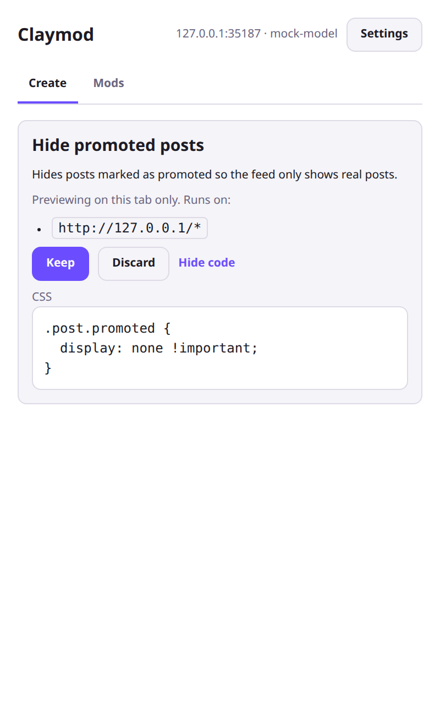
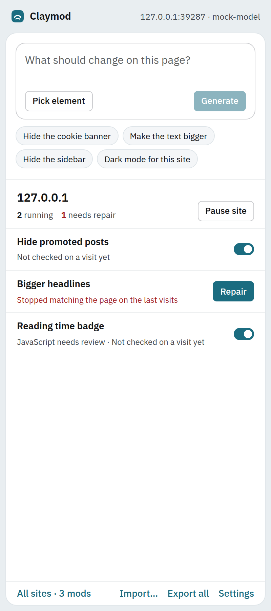

# Claymod

**Change any website by describing the change.**

"Hide the cookie banner." "Make this page dark." "Put the search box at the top."
Claymod asks an AI model to write that change **once**, as a small **mod** (CSS and/or JS). After
that, the extension re-applies the mod on every visit with **no AI calls**, checks that it still
fits the page, and helps you repair it when the site changes.

| Describe, preview, keep | The site's mods and their health |
| --- | --- |
|  |  |

- **Your model, your key, or none at all.** OpenAI-compatible endpoints (Ollama, LM Studio,
  OpenRouter, OpenAI), the Anthropic API, a local agent CLI (Claude Code, Codex, Gemini CLI,
  Antigravity CLI) through the optional [bridge](docs/bridge.md), or a small model running
  [on your GPU](docs/on-device.md) with no key.
- **Works with your agent.** Claude Code, Codex or OpenCode can read the page and propose mods
  over [MCP](docs/mcp.md); you approve every preview and save.
- **Private by default.** Page snapshots go only to the provider you configure. No telemetry,
  no Claymod server, fonts and model code built in.
- **Safe by design.** Generated JS runs only in Chrome's isolated user-script world, only on the
  sites the mod declares, and only after you've seen it. Site access is requested per site.
- **Mods that stay healthy.** Each mod checks that the page still has what it changes; after three
  failed visits it asks for a repair, and every version is kept so you can undo.

## Install

Claymod needs Chrome 135 or later.

1. Download `claymod-extension-<version>-chrome.zip` from the
   [latest release](https://github.com/ramiborni/claymod/releases/latest) and unzip it.
   (Chrome Web Store listing: coming soon.)
2. Open `chrome://extensions`, turn on **Developer mode**, click **Load unpacked** and choose the
   unzipped folder.
3. Click the Claymod icon in the toolbar, open **Settings** at the bottom of the panel, and pick a
   provider: an API key, a local server like Ollama, a local agent, or **On this device**. Click
   **Test connection**, then **Save**.
4. To run JavaScript mods, turn on **Allow User Scripts** for Claymod in `chrome://extensions`
   (Claymod tells you when a mod needs it).

Optional: [claymod-bridge](docs/bridge.md) for local agents and MCP, also on the release page
(macOS arm64/x64, Linux x64, Windows x64). Every release file is listed in `SHA256SUMS` and has a
build provenance attestation: `gh attestation verify <file> --repo ramiborni/claymod`.

## Use it

1. On any website, click the Claymod icon. Type what should change, or start from an idea.
   **Pick element** points at the part you mean.
2. Press **Enter**. Claymod writes the mod and previews it on this tab only. Flip **Before / After**
   to compare, **View code** to read it.
3. **Keep** asks Chrome for access to that site and saves the mod; **Discard** undoes the preview.
4. The site's mods are listed under the field: switch them off and on, open one for its code,
   rename, undo, export or delete. A red **Repair** appears when a mod stops matching the page.

**Starter mods.** Ten ready-made mods live in [`mods/`](mods/): hide cookie banners, comfortable
reading width, larger text, underlined links, visible keyboard focus, reduce motion, hide
newsletter pop-ups, hide share bars, a simple dark mode and stop autoplaying video. Download one
and use **Import…** in the panel.

## Develop

```bash
git clone https://github.com/ramiborni/claymod.git
cd claymod
bun install
bun dev        # opens Chrome with Claymod loaded
```

`bun run check`, `bun test`, `bun run e2e` and `bun run cypress` run the checks and tests; see
[CONTRIBUTING.md](CONTRIBUTING.md). `bun run release:artifacts` builds everything a release ships
([releasing](docs/releasing.md)).

| Path | What it is |
| --- | --- |
| `packages/core` | Pure TypeScript: mod schema, prompts, model providers, validation, health checks |
| `packages/extension` | The Chrome extension (WXT, Manifest V3) |
| `packages/bridge` | `claymod-bridge`: native messaging host for local agents, MCP server |
| `mods/` | Starter mods, validated in CI and tested on a synthetic page |
| `docs/` | [Architecture](docs/architecture.md), [mod format](docs/mod-format.md), [roadmap](docs/roadmap.md), [decisions](docs/decisions), [screenshots](docs/screenshots) |

## Contributing

Start with [CONTRIBUTING.md](CONTRIBUTING.md); a first PR (a starter mod, a provider or a local
agent) takes about 15 minutes. Please report security issues privately, as described in
[SECURITY.md](SECURITY.md). Everyone taking part follows our [Code of Conduct](CODE_OF_CONDUCT.md).

## License

[MIT](LICENSE). IBM Plex fonts: [SIL Open Font License](packages/extension/public/fonts/OFL.txt).
