# Screenshots

Captured from the real extension with a fake model and a synthetic page.
Regenerate with `SCREENSHOTS_DIR=$PWD/docs/screenshots bun run --cwd packages/extension screenshots`.

| | Light | Dark |
| --- | --- | --- |
| Picking an element | 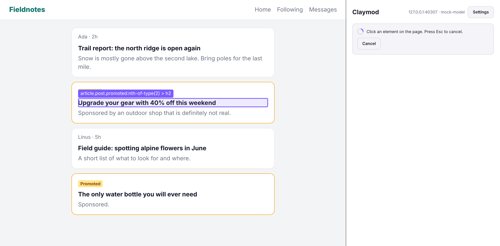 | 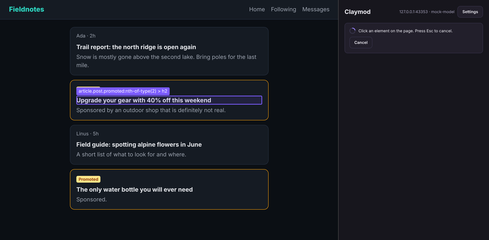 |
| Preview (promoted posts hidden) |  |  |
| Compose |  | 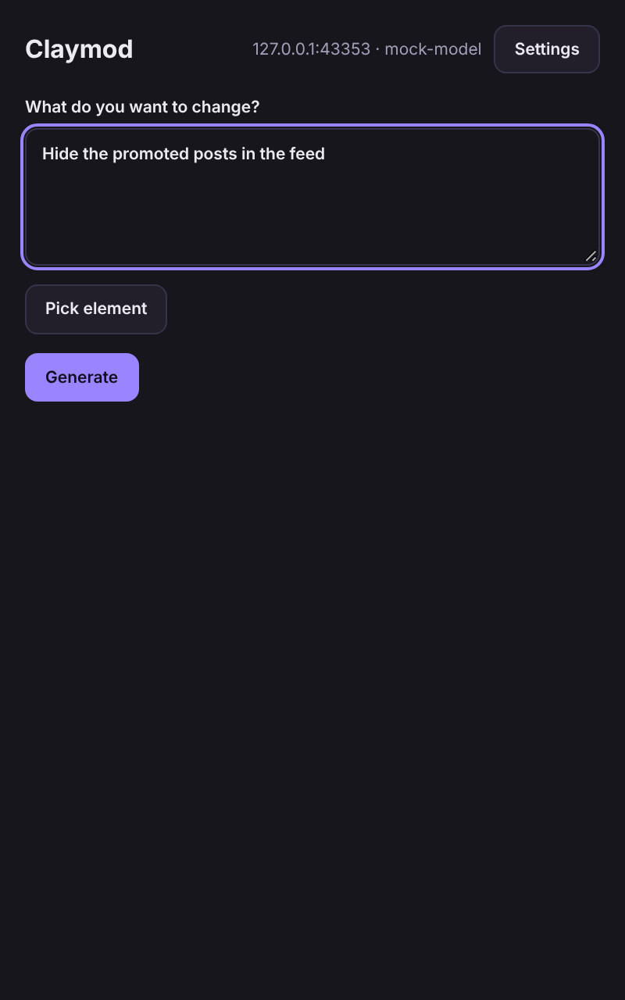 |
| Picked | 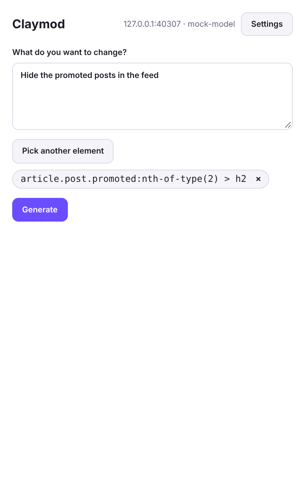 | 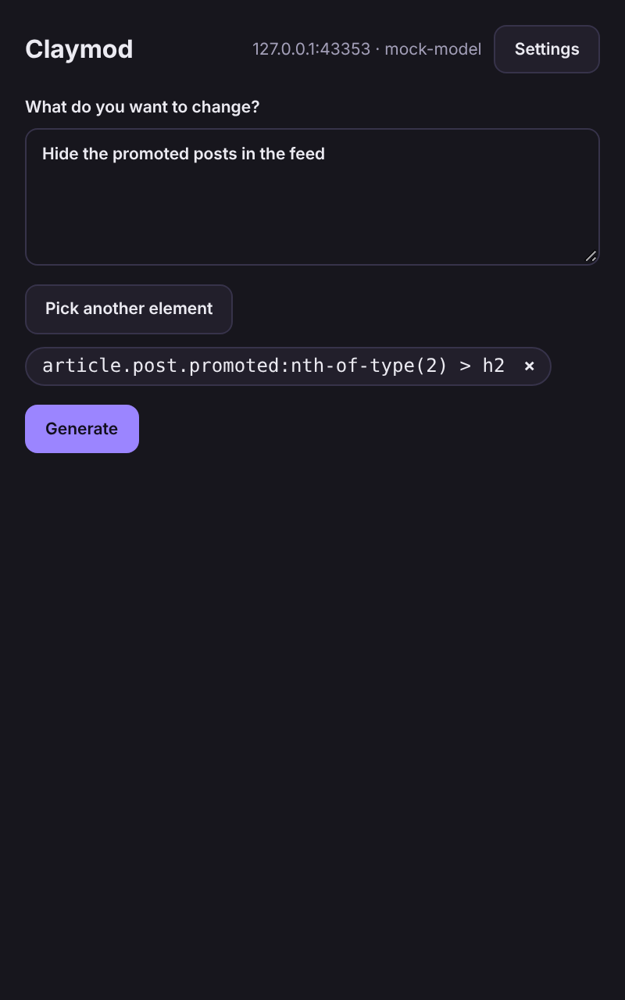 |
| Generating |  |  |
| Preview with code |  |  |
| Saved | 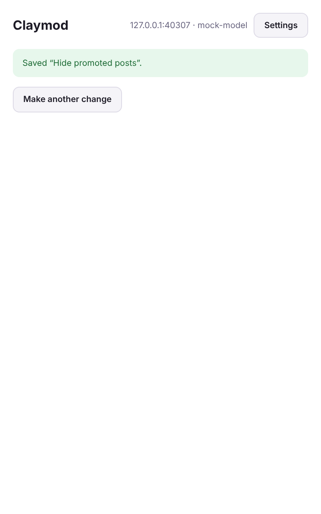 | 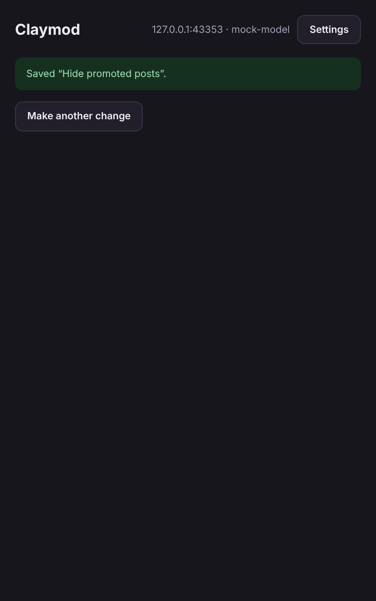 |
| Error | 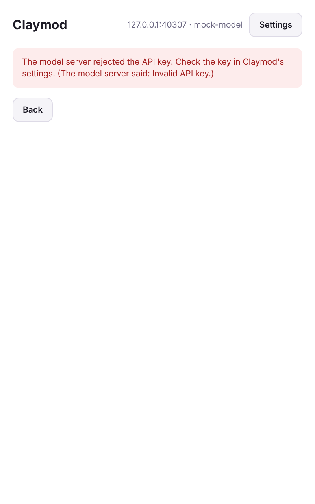 | 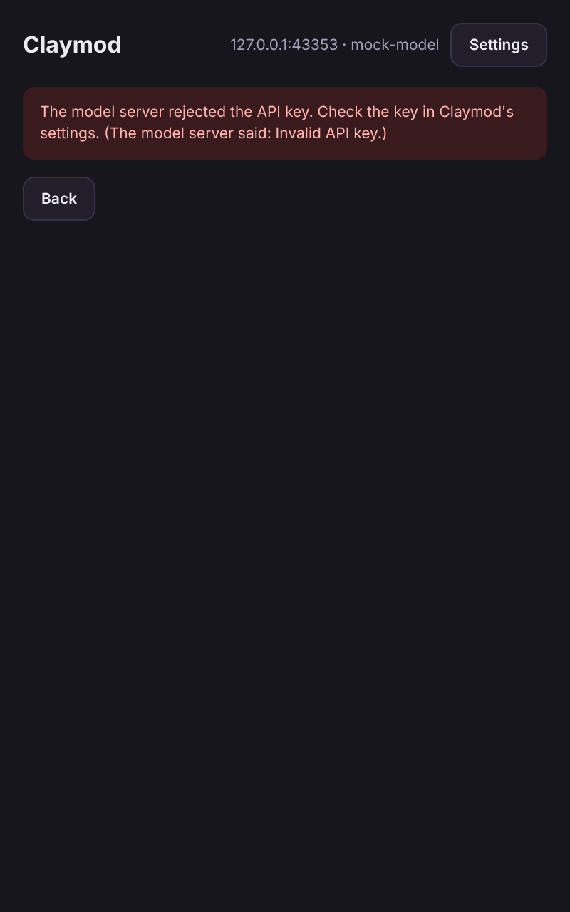 |
| Settings | 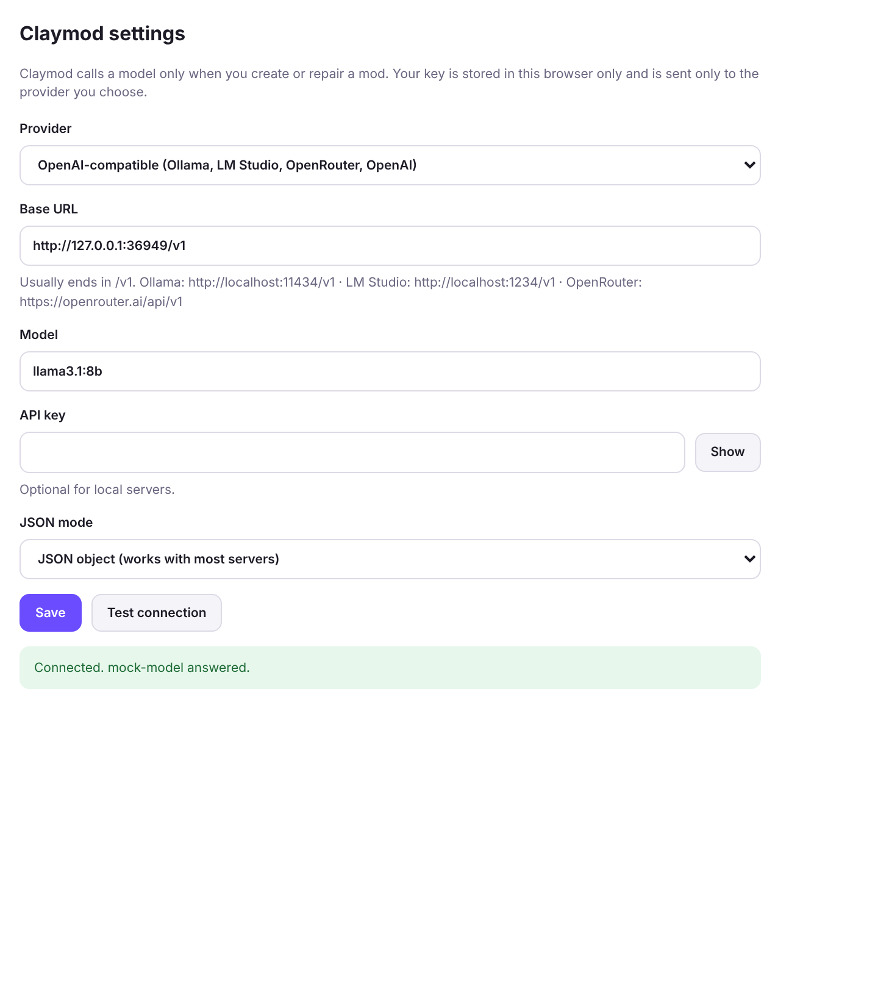 | 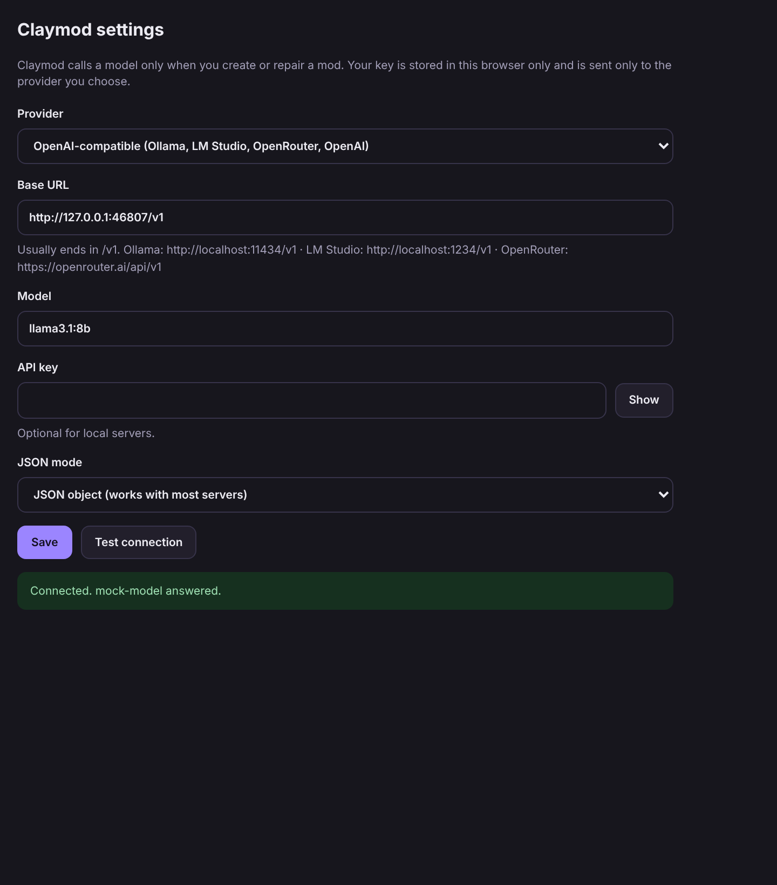 |
